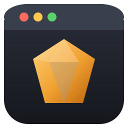
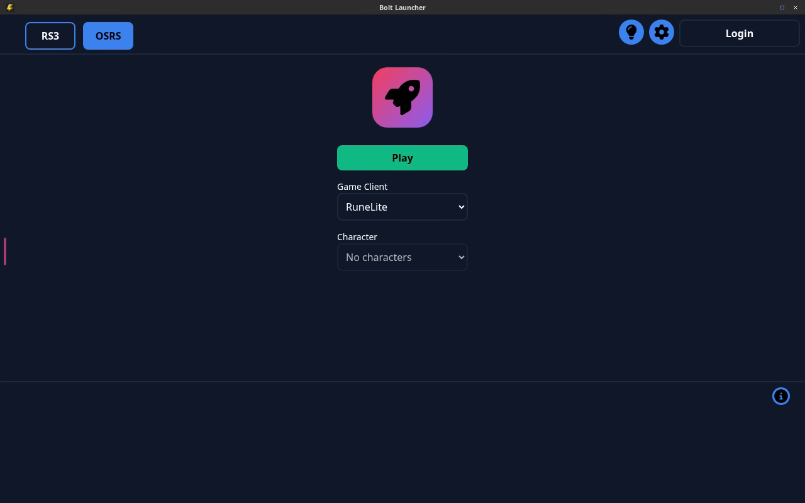
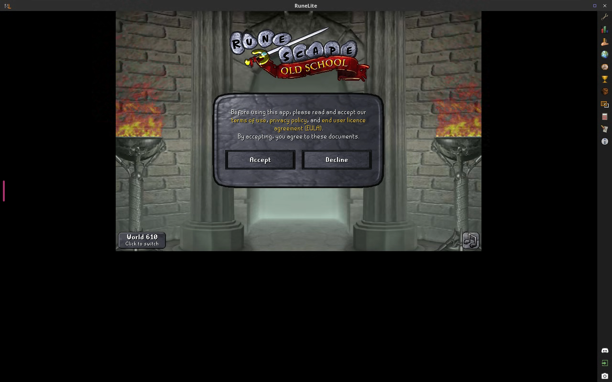

<p align="center">
  
</p>

<h1 align="center">runelite-web</h1>

<p align="center">
  <b>Play Old School RuneScape with RuneLite from any web browser.</b><br>
  The game runs on your server. Your laptop, Chromebook, tablet, or work PC just needs a browser.
</p>

<p align="center">
  <a href="https://github.com/GrantM28/runelite-web/actions/workflows/docker.yml"></a>
  <a href="https://github.com/GrantM28/runelite-web/pkgs/container/runelite-web"></a>
  <a href="LICENSE"></a>
</p>

| Log in with your Jagex Account | Play with RuneLite and all its plugins |
|---|---|
|  |  |

## Features

- **Jagex Accounts supported.** The open-source [Bolt launcher](https://codeberg.org/Adamcake/Bolt), a Linux alternative to the official Jagex Launcher, handles login, including 2FA, and starts RuneLite for you.
- **Full RuneLite.** It's the real client, and it updates itself. Plugin Hub plugins and settings are kept in your appdata folder.
- **Nothing to install on the device you play from.** The game is streamed by [Selkies](https://github.com/selkies-project/selkies) with sound, clipboard sync, and a resolution that adapts to your browser window.
- **Tuned for servers without a GPU.** Software rendering is set up out of the box, and the stream defaults (30 fps) suit older Xeons. A GPU is used if you pass one in.
- **Recovers on its own.** If Bolt or RuneLite closes, it's restarted automatically, and stale locks left by updates are cleared.
- **Unraid template included.** It also works with plain Docker or Compose.

## Quick start

### Unraid

```bash
wget -O /boot/config/plugins/dockerMan/templates-user/my-runelite-web.xml \
  https://raw.githubusercontent.com/GrantM28/runelite-web/main/unraid/runelite-web.xml
```

Then go to **Docker → Add Container → Template → runelite-web**, set a **Web password**, and click **Apply**. The full walkthrough is in **[docs/unraid.md](docs/unraid.md)**.

### Docker Compose

```yaml
services:
  runelite:
    image: ghcr.io/grantm28/runelite-web:latest
    container_name: runelite-web
    security_opt:
      - seccomp:unconfined   # needed by Bolt's embedded browser
    shm_size: "1gb"
    environment:
      - PUID=1000
      - PGID=1000
      - TZ=Etc/UTC
      - CUSTOM_USER=runelite
      - PASSWORD=change-me
    volumes:
      - ./config:/config
    ports:
      - 38443:3001
    restart: unless-stopped
```

### Docker CLI

```bash
docker run -d --name runelite-web \
  --security-opt seccomp=unconfined --shm-size=1g \
  -e CUSTOM_USER=runelite -e PASSWORD=change-me \
  -p 38443:3001 -v ./config:/config \
  --restart unless-stopped ghcr.io/grantm28/runelite-web:latest
```

### Then

1. Open `https://<server-ip>:38443` and accept the self-signed certificate warning.
2. Click **I Understand** in Bolt, then **Login**, and sign in with your Jagex Account.
3. Choose **RuneLite**, pick your character, and click **Play**.

## Configuration

| Variable | Default | Description |
|---|---|---|
| `CUSTOM_USER` / `PASSWORD` | – | Login for the web page. **Always set a password.** |
| `LAUNCH_MODE` | `bolt` | `bolt` starts the Bolt launcher (Jagex Accounts). `runelite` starts RuneLite directly. |
| `SELKIES_FRAMERATE` | `30,8-60` | Initial stream frame rate, then the range allowed in the sidebar. |
| `SELKIES_MANUAL_WIDTH` / `_HEIGHT` | – | Fixed stream resolution instead of matching the browser window. |
| `BOLT_GPU` | `false` | Set `true` to let Bolt use a GPU you passed in. |
| `BOLT_ARGS` | – | Extra command-line flags for Bolt. |
| `RUNELITE_JAVA_OPTS` / `RUNELITE_ARGS` | – | Extra JVM and launcher arguments when using `LAUNCH_MODE=runelite`. |
| `RESTART_APP` | `true` | Restart Bolt or RuneLite automatically when they close. |
| `PUID` / `PGID` / `TZ` | `911` / `911` / – | File ownership and time zone. On Unraid use `99` / `100`. |
| `SUBFOLDER` | `/` | Serve under a path such as `/runelite/` behind a reverse proxy. |

Any [Selkies setting](https://docs.linuxserver.io/selkies/user-guide/configuration/) (`SELKIES_*`) works too.

**Ports:** `3001` serves HTTPS with a self-signed certificate. `3000` serves plain HTTP and is only for a reverse proxy that handles TLS.
**Volume:** `/config` holds your Bolt login, RuneLite settings and plugins, and logs.

The right-click menu on the desktop can restart Bolt, run RuneLite without Bolt, open a terminal, or show live logs.

## Login options

- **Jagex Account via Bolt** (default): log in from the browser as shown above. Bolt keeps you signed in.
- **Jagex Account via a credentials file:** a fallback if Bolt ever stops working.
  1. On a Windows or Mac PC, follow RuneLite's guide for the `--insecure-write-credentials` option. This writes `.runelite/credentials.properties`.
  2. Copy that file to `<appdata>/.runelite/credentials.properties`.
  3. Set `LAUNCH_MODE=runelite`.

  Treat this file like a password.
- **Legacy (non-Jagex) accounts:** set `LAUNCH_MODE=runelite` and log in on the game's login screen.

## Guides

- **[Unraid setup](docs/unraid.md)**
- **[Remote access](docs/remote-access.md):** Tailscale, Cloudflare Tunnel and Access, and Nginx/SWAG/Traefik/NPM
- **[Performance tuning](docs/performance.md):** FPS, resolution, encoders, and GPU passthrough
- **[Troubleshooting](docs/troubleshooting.md)**

## Security

Anyone who can open this page controls your logged-in account. Always set a password, and don't expose the port to the internet directly. Use a VPN or an authenticating proxy. See [SECURITY.md](SECURITY.md).

## FAQ

**Is this allowed by Jagex?** RuneLite is an approved third-party client, and this project runs it unmodified. The only difference from a normal PC is that you see it through a remote-desktop-style stream, and nothing automates gameplay. Still, use it at your own risk. This project can't speak for Jagex.

**Is this a VM or remote desktop?** It's a remote desktop limited to one app: the game runs in the container and its window is streamed to you as video. That's why it works on any device with a browser.

**Does it support ARM or a Raspberry Pi?** Not yet. Bolt is only available for x86-64.

**Why Bolt 0.20.6?** It's the last release with a ready-made Linux build. Newer releases ship only source code. It works today. If Jagex changes their login flow, the image will need a newer Bolt built from source. Until then, the credentials-file login above is a fallback.

**Can I run more than one account?** Yes. Run one container per account, each with its own `/config` folder and port.

## How it works

```
Browser ──HTTPS/WebSocket──▶ nginx ─▶ Selkies (video encode, input, audio)
                                          │
                                   Xvfb + Openbox
                                          │
                     Bolt launcher (CEF) ─▶ RuneLite (Java 17, Mesa llvmpipe)
```

Built on [linuxserver/baseimage-selkies](https://github.com/linuxserver/docker-baseimage-selkies) (Debian trixie). Every build is smoke-tested before `latest` is updated: the test checks that the container boots, recreates it on the same config, waits for the Bolt window, and checks the password protection and healthcheck.

## Credits and license

The files in this repository are released under the [MIT license](LICENSE). The image bundles [Bolt](https://codeberg.org/Adamcake/Bolt) (AGPL-3.0), the [RuneLite launcher](https://github.com/runelite/launcher) (BSD-2), Eclipse Temurin, and linuxserver's Selkies base. See [THIRD_PARTY_NOTICES.md](THIRD_PARTY_NOTICES.md).

Not affiliated with Jagex, RuneLite, or Bolt. Old School RuneScape is a trademark of Jagex Ltd.
